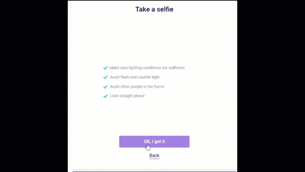
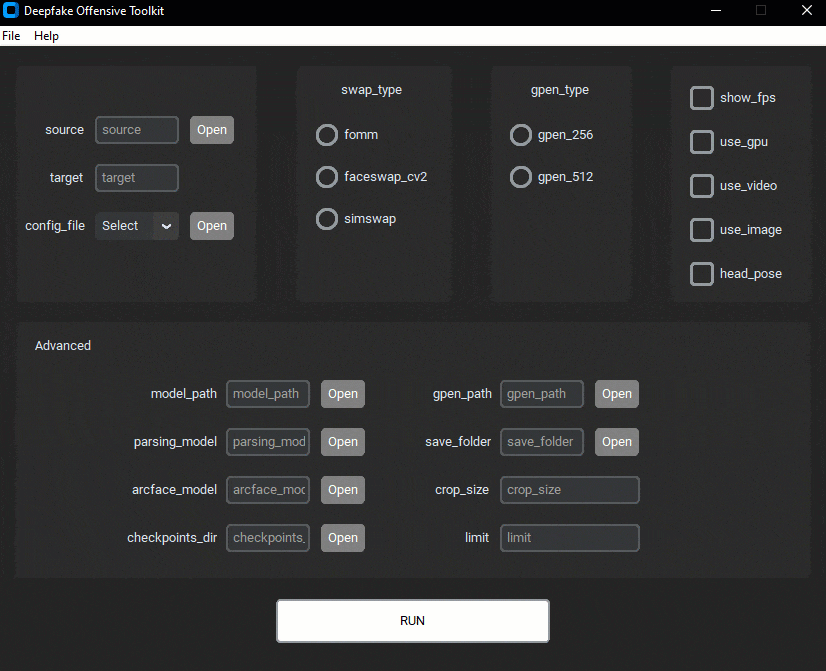
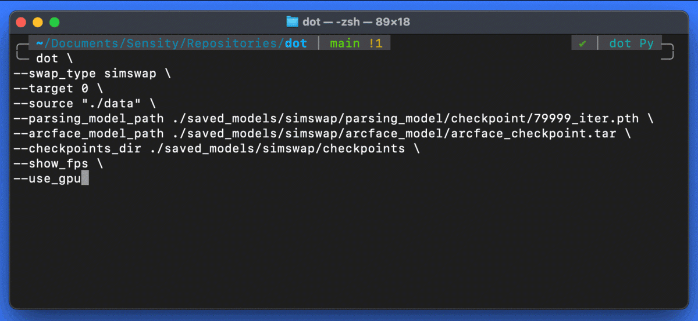

<div align="center">

<h1> the Deepfake Offensive Toolkit </h1>

[](https://github.com/sensity-ai/dot/stargazers)
[](https://github.com/sensity-ai/dot/blob/main/LICENSE)
[](https://www.python.org/downloads/)
[](https://github.com/sensity-ai/dot/actions/workflows/build_dot.yaml)
[](https://github.com/sensity-ai/dot/actions/workflows/code_check.yaml)

<a href="https://colab.research.google.com/github/sensity-ai/dot/blob/main/notebooks/colab_demo.ipynb"></a>

</div>

*dot* (aka Deepfake Offensive Toolkit) makes real-time, controllable deepfakes ready for virtual cameras injection. *dot* is created for performing penetration testing against e.g. identity verification and video conferencing systems, for the use by security analysts, Red Team members, and biometrics researchers.

If you want to learn more about *dot* is used for penetration tests with deepfakes in the industry, read these articles by [The Verge](https://www.theverge.com/2022/5/18/23092964/deepfake-attack-facial-recognition-liveness-test-banks-sensity-report) and [Biometric Update](https://www.biometricupdate.com/202205/sensity-alleges-biometric-onboarding-providers-downplaying-deepfake-threat).

dot *is developed for research and demonstration purposes. As an end user, you have the responsibility to obey all applicable laws when using this program. Authors and contributing developers assume no liability and are not responsible for any misuse or damage caused by the use of this program.*

<p align="center">

</p>

## How it works

In a nutshell, *dot* works like this


All deepfakes supported by *dot* do not require additional training. They can be used
in real-time on the fly on a photo that becomes the target of face impersonation.
Supported methods:

**Classic Methods:**
- face swap (via [SimSwap](https://github.com/neuralchen/SimSwap)), at resolutions `224` and `512`
  - with the option of face superresolution (via [GPen](https://github.com/yangxy/GPEN)) at resolutions `256` and `512`
- lower quality face swap (via OpenCV)
- [FOMM](https://github.com/AliaksandrSiarohin/first-order-model), First Order Motion Model for image animation

**Diffusion-Based Methods (Optional):**
- [ReActor](https://github.com/Gourieff/sd-webui-reactor) - Fast face swap using InsightFace's inswapper model (near real-time)
- [IP-Adapter Face](https://github.com/tencent-ailab/IP-Adapter) - Identity-preserving generation using Stable Diffusion
- [InstantID](https://github.com/InstantID/InstantID) - High-quality face swap using ControlNet + IP-Adapter with SDXL

## Running dot

### Graphical interface

#### GUI Installation

Download and run the dot executable for your OS:

- Windows (Tested on Windows 10 and 11):
  - Download `dot.zip` from [here](https://drive.google.com/file/d/1_duaEs2SAUGfAvr5oC4V3XR-ZzBtWQXo/view), unzip it and then run `dot.exe`
- Ubuntu:
  - ToDo
- Mac (Tested on Apple M2 Sonoma 14.0):

  - Download `dot-m2.zip` from [here](https://drive.google.com/file/d/1KTRzQrl_AVpiFIxUxW_k2F5EsosJJ_1Y/view?usp=sharing) and unzip it
  - Open terminal and run `xattr -cr dot-executable.app` to remove any extended attributes
  - In case of camera reading error:
    - Right click and choose `Show Package Contents`
    - Execute `dot-executable` from `Contents/MacOS` folder

#### GUI Usage

Usage example:

1. Specify the source image in the field `source`.
2. Specify the camera id number in the field `target`. In most cases, `0` is the correct camera id.
3. Specify the config file in the field `config_file`. Select a default configuration from the dropdown list or use a custom file.
4. (Optional) Check the field `use_gpu` to use the GPU.
5. Click on the `RUN` button to start the deepfake.

For more information about each field, click on the menu `Help/Usage`.

Watch the following demo video for better understanding of the interface

<p align="center">

</p>

### Command Line

#### CLI Installation

##### Install Pre-requisites

- Linux

    ```bash
    sudo apt install ffmpeg cmake
    ```

- MacOS

    ```bash
    brew install ffmpeg cmake
    ```

- Windows

    1. Download and install Visual Studio Community from [here](https://visualstudio.microsoft.com/vs/community/)
    2. Install Desktop development with C++ from the Visual studio installer

##### Create Conda Environment

> The instructions assumes that you have Miniconda installed on your machine. If you don't, you can refer to this [link](https://docs.conda.io/projects/conda/en/latest/user-guide/install/index.html) for installation instructions.

###### With GPU Support

**Option A: Conda**

```bash
conda env create -f envs/environment-gpu.yaml
conda activate dot
```

Install the `torch` and `torchvision` dependencies based on the CUDA version installed on your machine:

- Install CUDA 11.8 from [link](https://developer.nvidia.com/cuda-11-8-0-download-archive)
- Install `cudatoolkit` from `conda`: `conda install cudatoolkit=<cuda_version_no>` (replace `<cuda_version_no>` with the version on your machine)
- Install `torch` and `torchvision` dependencies: `pip install torch==2.0.1+<cuda_tag> torchvision==0.15.2+<cuda_tag> torchaudio==2.0.2 --index-url https://download.pytorch.org/whl/cu118`, where `<cuda_tag>` is the CUDA tag defined by Pytorch. For example, `pip install torch==2.0.1+cu118 torchvision==0.15.2+cu118 torchaudio==2.0.2 --index-url https://download.pytorch.org/whl/cu118` for CUDA 11.8.

  Note: `torch1.9.0+cu111` can also be used.

**Option B: uv and .venv (no conda)**

```bash
uv venv
source .venv/bin/activate   # Windows: .venv\Scripts\activate
uv pip install -r requirements.txt
# Optional: install PyTorch with CUDA (replace cu118 with your CUDA version)
uv pip install torch torchvision torchaudio --index-url https://download.pytorch.org/whl/cu118
uv pip install -e .   # installs the project and registers the `dot` command
```

Use the CUDA index that matches your system (e.g. `cu118` for CUDA 11.8). Then run e.g. `python -m dot -c ./configs/simswap.yaml --target 0 --source "./data" --use_gpu`.

To check that `torch` and `torchvision` are installed correctly, run: `python -c "import torch; print(torch.cuda.is_available())"`. If the output is `True`, the dependencies are installed with CUDA support.

###### With MPS Support (Apple Silicon: M1/M2/M3/M4)

**Do not use the PyTorch CUDA index on Mac** — it only provides Linux/Windows wheels. Use default PyPI so you get macOS ARM wheels with MPS support.

**Option A: Conda**

```bash
conda env create -f envs/environment-apple-m2.yaml
conda activate dot
```

**Option B: uv (recommended on Apple Silicon)**

```bash
uv sync
# or: uv venv && source .venv/bin/activate && uv pip install -e .
```

If you see errors about `torch+cu118` or missing `macosx_26_0_arm64` wheels, ensure no CUDA index is in use: unset `UV_EXTRA_INDEX_URL` and `PIP_EXTRA_INDEX_URL`, then run `uv lock` and `uv sync` again.

Then run e.g. `python -m dot -c ./configs/simswap.yaml --target 0 --source "./data" --use_gpu`, or with uv (no need to activate): `uv run python -m dot -c ./configs/simswap.yaml --target 0 --source "./data" --use_gpu`.

To check that `torch` and `torchvision` are installed correctly, run: `python -c "import torch; print(torch.backends.mps.is_available())"`. If the output is `True`, the dependencies are installed with Metal (MPS) support.

###### With CPU Support (slow, not recommended)

```bash
conda env create -f envs/environment-cpu.yaml
conda activate dot
```

##### Install dot

```bash
pip install -e .
```

##### Install Diffusion Models (Optional)

The diffusion-based face swap models (ReActor, IP-Adapter Face, InstantID) require additional dependencies. Install them based on which models you want to use:

```bash
# Install ReActor (fastest diffusion option)
pip install -e ".[reactor]"

# Install IP-Adapter Face
pip install -e ".[ipadapter]"

# Install InstantID (highest quality)
pip install -e ".[instantid]"

# Install all diffusion models
pip install -e ".[all-diffusion]"
```

Note: Diffusion models require more VRAM than classic methods. A GPU with at least 8GB VRAM is recommended for IP-Adapter and InstantID.

You can run dot either as the `dot` command (when the env is activated) or with Python:

```bash
python -m dot -c ./configs/simswap.yaml --target 0 --source "./data" --use_gpu
# or with uv (no need to activate):
uv run python -m dot -c ./configs/simswap.yaml --target 0 --source "./data" --use_gpu
```

##### Download Models

- Download dot model checkpoints from [here](https://drive.google.com/file/d/1Y_11R66DL4N1WY8cNlXVNR3RkHnGDGWX/view)
- Unzip the downloaded file in the root of this project

#### CLI Usage

Run `python -m dot --help` (or `dot --help` if the env is activated) for a full list of options.

1. Simswap

    ```bash
    python -m dot -c ./configs/simswap.yaml --target 0 --source "./data" --use_gpu
    ```

2. SimSwapHQ

    ```bash
    python -m dot -c ./configs/simswaphq.yaml --target 0 --source "./data" --use_gpu
    ```

3. FOMM

    ```bash
    python -m dot -c ./configs/fomm.yaml --target 0 --source "./data" --use_gpu
    ```

4. FaceSwap CV2

    ```bash
    python -m dot -c ./configs/faceswap_cv2.yaml --target 0 --source "./data" --use_gpu
    ```

**Note**: To enable face superresolution, use the flag `--gpen_type gpen_256` or `--gpen_type gpen_512`. To use *dot* on CPU (not recommended), do not pass the `--use_gpu` flag.

#### Camera/Film Filters

Apply realistic camera degradation effects to make deepfakes look more natural:

```bash
# Apply webcam quality filter
python -m dot -c ./configs/simswap.yaml --target 0 --source "./data" --use_gpu --filter webcam_720p

# Apply security camera look
python -m dot --swap_type reactor --target 0 --source "./data" --use_gpu --filter security_cam
```

**Available filters:**

| Filter | Description |
|--------|-------------|
| `webcam_720p` | Typical webcam: slight blur, warm color cast, reduced dynamic range |
| `webcam_480p` | Low-quality webcam: more blur, noise, compression artifacts |
| `film_grain` | Film camera: grain noise, subtle color shifts, vignette |
| `security_cam` | CCTV look: low contrast, noise, heavy compression |
| `phone_front` | Front-facing phone: slight softness, warm tones |

**Keyboard controls (camera mode):**

| Key | Action |
|-----|--------|
| `f` | Next filter |
| `d` | Previous filter |
| `g` | Disable filter |

#### Diffusion-Based Models (Optional)

These models require the optional diffusion dependencies to be installed (see [Install Diffusion Models](#install-diffusion-models-optional)).

5. ReActor (Fast Face Swap)

    ```bash
    python -m dot -c ./configs/reactor.yaml --target 0 --source "./data" --use_gpu
    ```

    ReActor is the fastest diffusion-based option, achieving near real-time performance. It uses InsightFace's inswapper model.

6. IP-Adapter Face

    ```bash
    python -m dot -c ./configs/ipadapter_face.yaml --target 0 --source "./data" --use_gpu
    ```

    IP-Adapter Face uses Stable Diffusion with a face embedding adapter. For higher quality (but slower), use SDXL:

    ```bash
    python -m dot --swap_type ipadapter_face --target 0 --source "./data" --use_gpu --use_sdxl
    ```

7. InstantID

    ```bash
    python -m dot -c ./configs/instantid.yaml --target 0 --source "./data" --use_gpu
    ```

    InstantID provides the highest quality results using ControlNet with SDXL. For faster inference, use the LCM variant:

    ```bash
    python -m dot -c ./configs/instantid_lcm.yaml --target 0 --source "./data" --use_gpu
    ```

#### Diffusion Model CLI Options

The diffusion models support additional CLI options:

| Option | Description | Default |
|--------|-------------|---------|
| `--num_inference_steps` | Number of diffusion steps (more = higher quality, slower) | 20 |
| `--guidance_scale` | Classifier-free guidance scale | 7.5 |
| `--use_lcm` | Use LCM scheduler for faster inference | False |
| `--controlnet_scale` | ControlNet conditioning scale (InstantID only) | 0.8 |
| `--ip_adapter_scale` | IP-Adapter influence scale | 0.8 |
| `--use_sdxl` | Use SDXL model (IP-Adapter Face only) | False |
| `--use_face_restore` | Apply face restoration (ReActor only) | True |
| `--face_restore_model` | Face restoration model: `codeformer` or `gfpgan` | codeformer |

Example with custom options:

```bash
python -m dot --swap_type instantid --target 0 --source "./data" --use_gpu \
    --num_inference_steps 30 --guidance_scale 5.0 --ip_adapter_scale 0.9
```

#### Controlling dot with CLI

> **Disclaimer**: We use the `SimSwap` technique for the following demonstration

Running *dot* via any of the above methods generates real-time Deepfake on the input video feed using source images from the `data/` folder.

<p align="center">

</p>

When running *dot* a list of available control options appear on the terminal window as shown above. You can toggle through and select different source images by pressing the associated control key.

Watch the following demo video for better understanding of the control options:

<p align="center">

</p>

## Docker

### Setting up docker

- Build the container

    ```
    docker-compose up --build -d
    ```

- Access the container

    ```
    docker-compose exec dot "/bin/bash"
    ```

### Connect docker to the webcam

#### Ubuntu

1. Build the container

    ```
    docker build -t dot -f Dockerfile .
    ```

2. Run the container

    ```
    xhost +
    docker run -ti --gpus all \
    -e NVIDIA_DRIVER_CAPABILITIES=compute,utility \
    -e NVIDIA_VISIBLE_DEVICES=all \
    -e PYTHONUNBUFFERED=1 \
    -e DISPLAY \
    -v .:/dot \
    -v /tmp/.X11-unix:/tmp/.X11-unix:rw \
    --runtime nvidia \
    --entrypoint /bin/bash \
    -p 8080:8080 \
    --device=/dev/video0:/dev/video0 \
    dot
    ```

#### Windows

1. Follow the instructions [here](https://medium.com/@jijupax/connect-the-webcam-to-docker-on-mac-or-windows-51d894c44468) under Windows to set up the webcam with docker.

2. Build the container

    ```
    docker build -t dot -f Dockerfile .
    ```
3. Run the container

    ```
    docker run -ti --gpus all \
    -e NVIDIA_DRIVER_CAPABILITIES=compute,utility \
    -e NVIDIA_VISIBLE_DEVICES=all \
    -e PYTHONUNBUFFERED=1 \
    -e DISPLAY=192.168.99.1:0 \
    -v .:/dot \
    --runtime nvidia \
    --entrypoint /bin/bash \
    -p 8080:8080 \
    --device=/dev/video0:/dev/video0 \
    -v /tmp/.X11-unix:/tmp/.X11-unix \
    dot
    ```

#### macOS

1. Follow the instructions [here](https://github.com/gzupark/boot2docker-webcam-mac/blob/master/README.md) to set up the webcam with docker.

2. Build the container

    ```
    docker build -t dot -f Dockerfile .
    ```
3. Run the container

    ```
    docker run -ti --gpus all \
    -e NVIDIA_DRIVER_CAPABILITIES=compute,utility \
    -e NVIDIA_VISIBLE_DEVICES=all \
    -e PYTHONUNBUFFERED=1 \
    -e DISPLAY=$IP:0 \
    -v .:/dot \
    -v /tmp/.X11-unix:/tmp/.X11-unix \
    --runtime nvidia \
    --entrypoint /bin/bash \
    -p 8080:8080 \
    --device=/dev/video0:/dev/video0 \
    dot
    ```

## Virtual Camera Injection

Instructions vary depending on your operating system.

### Windows

- Install [OBS Studio](https://obsproject.com/).

- Run OBS Studio.

- In the Sources section, press on Add button ("+" sign),

  select Windows Capture and press OK. In the appeared window,
  choose "[python.exe]: fomm" in Window drop-down menu and press OK.
  Then select Edit -> Transform -> Fit to screen.

- In OBS Studio, go to Tools -> VirtualCam. Check AutoStart,

  set Buffered Frames to 0 and press Start.

- Now `OBS-Camera` camera should be available in Zoom

  (or other videoconferencing software).

### Ubuntu

```bash
sudo apt update
sudo apt install v4l-utils v4l2loopback-dkms v4l2loopback-utils
sudo modprobe v4l2loopback devices=1 card_label="OBS Cam" exclusive_caps=1
v4l2-ctl --list-devices
sudo add-apt-repository ppa:obsproject/obs-studio
sudo apt install obs-studio
```

Open `OBS Studio` and check if `tools --> v4l2sink` exists.
If it doesn't follow these instructions:

```bash
mkdir -p ~/.config/obs-studio/plugins/v4l2sink/bin/64bit/
ln -s /usr/lib/obs-plugins/v4l2sink.so ~/.config/obs-studio/plugins/v4l2sink/bin/64bit/
```

Use the virtual camera with `OBS Studio`:

- Open `OBS Studio`
- Go to `tools --> v4l2sink`
- Select `/dev/video2` and `YUV420`
- Click on `start`
- Join a meeting and select `OBS Cam`

### MacOS

- Download and install OBS Studio for MacOS from [here](https://obsproject.com/)
- Open OBS and follow the first-time setup (you might be required to enable certain permissions in *System Preferences*)
- Run *dot* with `--use_cam` flag to enable camera feed
- Click the "+" button in the sources section → select "Windows Capture", create a new source and enter "OK" → select window with "python" included in the name and enter OK
- Click "Start Virtual Camera" button in the controls section
- Select "OBS Cam" as default camera in the video settings of the application target of the injection

## Run dot with an Android emulator

If you are performing a test against a mobile app, virtual cameras are much harder to inject. An alternative is to use mobile emulators and still resort to virtual camera injection.

- Run `dot`. Check [running dot](https://github.com/sensity-ai/dot#running-dot) for more information.

- Run `OBS Studio` and set up the virtual camera. Check [virtual-camera-injection](https://github.com/sensity-ai/dot#virtual-camera-injection) for more information.

- Download and Install [Genymotion](https://www.genymotion.com/download/).

- Open Genymotion and set up the Android emulator.

- Set up dot with the Android emulator:
  - Open the Android emulator.
  - Click on `camera` and select `OBS-Camera` as front and back cameras. A preview of the dot window should appear.
  In case there is no preview, restart `OBS` and the emulator and try again.
  If that didn't work, use a different virtual camera software like `e2eSoft VCam` or `ManyCam`.
  - `dot` deepfake output should be now the emulator's phone camera.

## Speed

### Classic Methods

#### With GPU

Tested on a AMD Ryzen 5 2600 Six-Core Processor with one NVIDIA GeForce RTX 2070

```example
Simswap: FPS 13.0
Simswap + gpen 256: FPS 7.0
SimswapHQ: FPS 11.0
FOMM: FPS 31.0
```

#### With Apple Silicon

Tested on Macbook Air M2 2022 16GB
```example
Simswap: FPS 3.2
Simswap + gpen 256: FPS 1.8
SimswapHQ: FPS 2.7
FOMM: FPS 2.0
```

### Diffusion-Based Methods

Performance expectations for diffusion models (GPU required):

| Model | Inference Steps | Time/Frame | Real-time Capable? |
|-------|-----------------|------------|-------------------|
| ReActor | 1-4 | 0.5-1s | Near real-time |
| IP-Adapter Face (SD1.5) | 20 | 1-3s | No |
| IP-Adapter Face (SDXL) | 20 | 3-5s | No |
| InstantID | 20 | 2-5s | No |
| InstantID + LCM | 4 | 1-2s | Marginal |

**Notes:**
- ReActor is recommended for real-time applications
- InstantID provides the highest quality but is slower
- Use `--use_lcm` with InstantID to reduce inference time
- Reduce `--num_inference_steps` for faster (but lower quality) results

## License

*This is not a commercial Sensity product, and it is distributed freely with no warranties*

The software is distributed under [BSD 3-Clause](LICENSE).
*dot* utilizes several open source libraries. If you use *dot*, make sure you agree with their
licenses too. In particular, this codebase is built on top of the following research projects:

- <https://github.com/AliaksandrSiarohin/first-order-model>
- <https://github.com/alievk/avatarify-python>
- <https://github.com/neuralchen/SimSwap>
- <https://github.com/yangxy/GPEN>
- <https://github.com/deepinsight/insightface>
- <https://github.com/Gourieff/sd-webui-reactor>
- <https://github.com/tencent-ailab/IP-Adapter>
- <https://github.com/InstantID/InstantID>

## Contributing

If you have ideas for improving *dot*, feel free to open relevant Issues and PRs. Please read [CONTRIBUTING.md](./CONTRIBUTING.md) before contributing to the repository.

## Maintainers

- [@ghassen1302](https://github.com/ghassen1302)
- [@vassilispapadop](https://github.com/vassilispapadop)
- [@giorgiop](https://github.com/giorgiop)
- [@AjinkyaIndulkar](https://github.com/AjinkyaIndulkar)
- [@kjod](https://github.com/kjod)

## Contributors

[](https://github.com/sensity-ai/dot/graphs/contributors)

<a href="https://github.com/sensity-ai/dot/graphs/contributors">
  
</a>

## Additional Documentation

- [Run *dot* on image and video files instead of camera feed](docs/run_without_camera.md)
- [Camera/Film Filters](docs/filters.md) - Make deepfakes look more realistic with camera effects
- [Model Commands Reference](docs/model_commands.md) - Complete CLI reference for all models

## FAQ

- **`dot` is very slow and I can't run it in real time**

Make sure that you are running it on a GPU card by using the `--use_gpu` flag. CPU is not recommended.
If you still find it too slow it may be because you running it on an old GPU model, with less than 8GB of RAM.

- **Does `dot` only work with a webcam feed or also with a pre-recorded video?**

You can use `dot` on a pre-recorded video file by [these scripts](docs/run_without_camera.md) or try it directly on [Colab](https://colab.research.google.com/github/sensity-ai/dot/blob/main/notebooks/colab_demo.ipynb).
